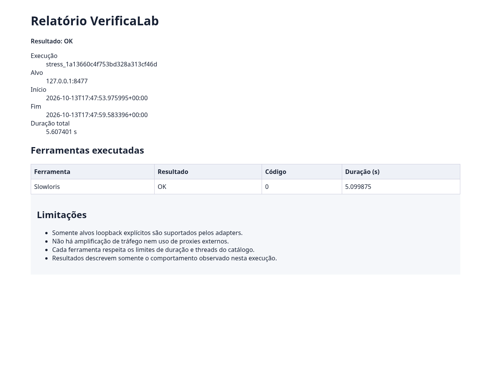
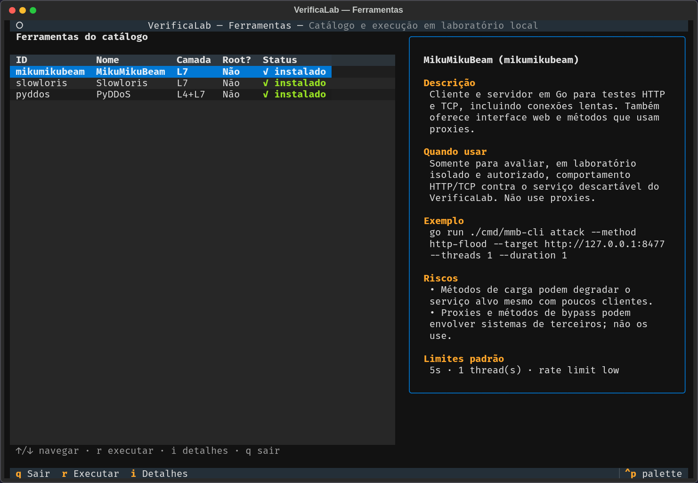

# VerificaLab

> Plataforma local para testes controlados de segurança. Verificações
> de contrato HTTP, testes de stress autorizados e relatórios
> reproduzíveis — com **gate de autorização obrigatório**, **kill-tree
> em subprocessos** e suíte de **257 testes**.

[](https://github.com/Kayquebrigadeiro/VerificadordeSeguran-a/actions)
[](https://www.python.org/)
[](LICENSE)
[]()

## Por que este projeto existe

Ferramentas de stress test são **perigosas quando não têm disciplina**.
Elas são fáceis de rodar, fáceis de apontar para o alvo errado, e
fáceis de deixar processos órfãos no sistema.

O VerificaLab foi construído ao redor de três princípios:

1. **Gate de autorização obrigatório** — `require_authorization()`
   bloqueia qualquer alvo que não seja loopback sem um
   `authorization.json` assinado pelo dono.
2. **Fail-closed** — se o runner não consegue garantir os limites
   (duração, threads, alvo), ele **recusa executar**. Não há
   fallback permissivo.
3. **Kill-tree real** — subprocessos são encerrados em grupo
   (`start_new_session=True` + `killpg`). Testado com processo
   filho real, zero órfãos em todas as execuções.

## O que faz

- **Verificações de contrato HTTP** — status, `Content-Type`,
  campos JSON, tempo máximo de resposta
- **Observações de configuração** — headers de segurança, cookies,
  TLS — com **conclusão contextualizada** (não "vulnerabilidade")
- **Testes de stress autorizados** contra alvo loopback, com
  limite de duração/threads aplicado pelo catálogo declarativo
- **Relatórios** em JSON, Markdown e HTML
- **Importação** de JUnit XML e JSON de relatórios externos
- **Cancelamento via API** com encerramento de árvore de processos
- **TUI** com painel de ferramentas e descrição de uso

## Screenshots

### Suíte de testes

```
-- Docs: https://docs.pytest.org/en/stable/how-to/capture-warnings.html
218 passed, 3 skipped, 1 warning in 40.30s
```

### Relatório HTML gerado



### Painel de ferramentas (TUI)



## O que **não** faz

- Não executa nada contra alvos externos sem autorização assinada
- Não usa proxies públicos, amplificação, spoofing ou botnets
- Não redistribui ferramentas ofensivas de terceiros
- Não substitui revisão manual de segurança

## Arquitetura

```
┌──────────────────────────────────────────────────────────┐
│                    CLI / TUI                              │
│    make serve | make tui | make test                      │
└─────────────┬────────────────────────────────────────────┘
              │
┌─────────────▼────────────────────────────────────────────┐
│                FastAPI (loopback only)                    │
│    projetos · ambientes · execuções · relatórios          │
└─────────────┬────────────────────────────────────────────┘
              │
┌─────────────▼────────────────────────────────────────────┐
│                  Orchestrator                             │
│  ┌──────────────────┐   ┌────────────────────┐           │
│  │ Authorization    │ → │ StressAdapter      │           │
│  │ gate             │   │ + clamp de limites │           │
│  └──────────────────┘   └─────────┬──────────┘           │
│                                   │                      │
│  ┌────────────────────────────────▼───────────────────┐  │
│  │   Runner (subprocess + kill-tree, sem shell)       │  │
│  └────────────────────────────────────────────────────┘  │
└──────────────────────────────────────────────────────────┘
```

## Ferramentas suportadas

O repo público inclui **3 ferramentas de referência** (todas L7,
todas sem root) que servem para validar os adapters:

| Ferramenta | Camada | Modo |
|---|---|---|
| [Slowloris](tools/slowloris) | L7 | Conexões HTTP incompletas |
| [MikuMikuBeam](tools/mikumikubeam) | L7 | HTTP flood em Go |
| [PyDDoS](tools/pyddos) | L7 | HTTP flood com rotação de UA |

Adicionar outra ferramenta exige quatro passos:
1. Criar um adapter em `backend/verificalab/stress/adapters/`
2. Registrar em `config/tools.yaml` com limites declarados
3. Escrever testes que cubram loopback + fail-closed
4. Documentar riscos e uso

Ferramentas que exigem root, menu interativo, ou dependem de
terceiros (amplificação, open redirect, proxies públicos) **não
são suportadas** — por design.

## Instalação

```bash
git clone https://github.com/Kayquebrigadeiro/VerificadordeSeguran-a.git
cd VerificadordeSeguran-a
make bootstrap
```

O `bootstrap.sh`:
1. Cria `.venv/`
2. Instala o backend com extras de teste
3. Compila o frontend React
4. Aplica migrações SQLite
5. Cria projeto de demonstração
6. Roda a suíte

## Uso

```bash
make serve   # API + laboratório em loopback (http://127.0.0.1:8400)
make tui     # Painel interativo de ferramentas
make test    # Suíte completa
make help    # Lista targets disponíveis
```

## Estrutura

```
.
├── backend/verificalab/
│   ├── core/
│   │   ├── authorization.py    ← gate obrigatório
│   │   ├── runner.py           ← subprocess + kill-tree
│   │   ├── orchestrator.py     ← orquestra execuções
│   │   └── report.py           ← JSON / MD / HTML
│   ├── stress/
│   │   ├── base.py             ← StressAdapter (ABC)
│   │   ├── registry.py         ← carrega config/tools.yaml
│   │   └── adapters/           ← um por ferramenta
│   ├── executors/              ← httpchecks · loadgen · suite
│   ├── api/                    ← FastAPI
│   └── tui/                    ← Textual
├── backend/tests/              ← 257 testes
├── frontend/                   ← React + TypeScript + Vite
├── tools/                      ← 3 ferramentas de referência
├── docs/
│   ├── GUIA_DE_USO.md
│   ├── PENDENCIAS.md
│   ├── HOMOLOGACAO_FINAL.md
│   └── STRESS_ORCHESTRATION.md
├── config/tools.yaml           ← catálogo declarativo
├── Makefile
└── bootstrap.sh
```

## Segurança

- **Gate de autorização** — `core/authorization.py` bloqueia
  qualquer alvo que não seja loopback sem autorização assinada.
  Coberto por 19 testes.
- **Kill-tree** — `core/runner.py` encerra o grupo de processos
  em timeout ou cancelamento. Testado com processo filho real.
- **Fail-closed** — adapters recusam executar quando não conseguem
  garantir limites. Não há caminho permissivo.
- **Sem shell** — subprocessos usam lista de argumentos, nunca
  `shell=True`.
- **Sem dependências de rede externa** — nenhum adapter baixa
  proxies, listas públicas ou atualizações.

## Documentação

- [Guia de uso](docs/GUIA_DE_USO.md)
- [Pendências e limitações](docs/PENDENCIAS.md)
- [Relatório de homologação](docs/HOMOLOGACAO_FINAL.md)
- [Arquitetura de stress orchestration](docs/STRESS_ORCHESTRATION.md)

## Aviso legal

**Use apenas contra sistemas próprios ou com autorização escrita.**

No Brasil, testes de stress contra sistemas de terceiros são
regulados pela **Lei 12.737/2012** (Lei Carolina Dieckmann). Fora
do Brasil, valem equivalentes como o **CFAA** (EUA) e o
**Computer Misuse Act** (Reino Unido).

O gate de autorização do VerificaLab existe para tornar essa
fronteira explícita. Não tente contorná-lo.

## Licença

MIT — ver [LICENSE](LICENSE).
